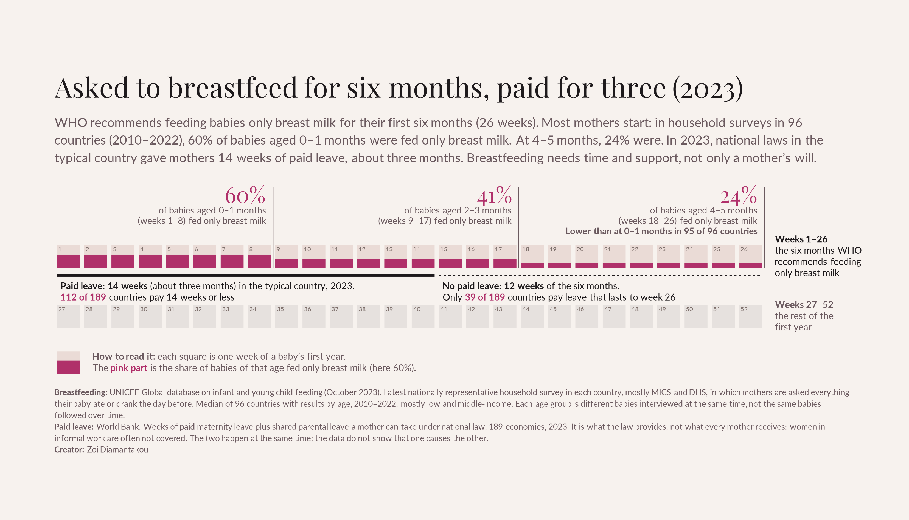

# Asked to breastfeed for six months, paid for three

**A data story on exclusive breastfeeding and paid leave for mothers, built entirely in R.**



## The story

WHO recommends feeding babies only breast milk for their first six months (26 weeks). When mothers stop early, it is often treated as their own failure. The data tell a different story: breastfeeding needs time and support, not only a mother's will.

- **Most mothers start.** In household surveys in 96 countries (2010–2022), 60% of babies aged 0–1 months were fed only breast milk.
- **Few keep going for six months.** At 2–3 months the share was 41%, and at 4–5 months 24%. It was lower at 4–5 months than at 0–1 months in 95 of the 96 countries.
- **Paid leave stops halfway.** In 2023 national laws in the typical country gave mothers 14 weeks of paid leave, about three months. 112 of 189 countries paid 14 weeks or less, and only 39 paid leave that lasts to week 26.

The two happen at the same time. The data do not show that the end of paid leave causes the drop, but they show that most mothers are asked for six months and supported for three.

## How to read the visual

| Element | What it shows |
|---|---|
| Squares | The 52 weeks of a baby's first year, laid out like a calendar |
| Top row | Weeks 1–26, the six months WHO recommends feeding only breast milk |
| Pink part of each square | The share of babies of that age fed only breast milk (median of 96 countries) |
| Solid line under weeks 1–14 | Paid leave in the typical country, 2023 |
| Dashed line under weeks 15–26 | The weeks of the six months without paid leave |
| Bottom row | Weeks 27–52, the rest of the first year |

## Data

| File | Indicator | Source |
|---|---|---|
| `data/ExclusiveBF_2023.xlsx` | Exclusive breastfeeding: % of infants 0–5 months fed only breast milk the previous day, by age group | UNICEF Global database on infant and young child feeding (October 2023) |
| `data/PaidLeave.csv` | Length of paid maternity, paternity and shared parental leave (calendar days), 1970–2023 | World Bank |

### How the data were collected

- **Breastfeeding comes from household surveys, not administrative records.** Each country's figure is from its latest nationally representative survey, mostly Multiple Indicator Cluster Surveys (MICS, 49 countries) and Demographic and Health Surveys (DHS, 36). An interviewer asks the mother everything her baby ate or drank the day before. A baby counts as exclusively breastfed if it had only breast milk (medicines and oral rehydration salts are allowed). UNICEF re-analyses the surveys so that countries are comparable.
- **Paid leave is what the law says.** The World Bank records the number of paid days a mother is entitled to under national law. It shows the length of the leave, not the level of pay, and not whether a mother actually gets it.

### Data notes

- **Different babies, not the same babies over time.** Each age group (0–1, 2–3, 4–5 months) is a different group of babies interviewed in the same survey. The fall from 60% to 24% compares younger and older babies; it does not follow individual mothers.
- **Which countries.** Breastfeeding data by age exist for 96 countries, mostly low and middle-income. Paid leave covers 189 economies. "Typical" means the median of each set.
- **Weeks and months.** The age groups are placed on the calendar as weeks 1–8 (0–1 months), 9–17 (2–3 months) and 18–26 (4–5 months).
- **Leave a mother can take.** Paid leave = maternity leave plus shared parental leave. Countries such as Norway and Sweden give leave only as shared parental leave, so maternity leave alone would wrongly show them at zero.
- **Informal work.** Many women, especially in low-income countries, work informally and are not covered by leave laws, so the real gap is likely larger than shown.

## Run it

```r
# install.packages(c("tidyverse", "readxl", "ggtext", "showtext"))
source("breastfeeding.R")   # writes breastfeeding.png
```

Fonts (Playfair Display and Lato) are loaded from Google Fonts by `showtext`, so an internet connection is needed the first time.

## Repo layout

| Path | What's inside |
|---|---|
| `breastfeeding.R` | The full script: data, indicators and the visual |
| `breastfeeding.png` | The visual |
| `data/` | UNICEF breastfeeding workbook and World Bank paid leave data, as downloaded |

Made by [Zoi Diamantakou](https://github.com/ZoiDiama)
